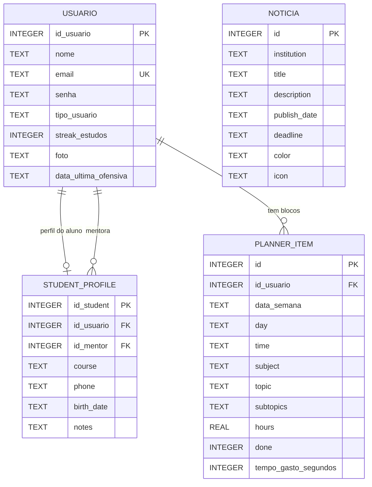

# Primeira Chamada MED — Documentação Técnica

**Planner de estudos com acompanhamento de mentores**

**Integrantes:** Davi Brunelli, Talita Canedo e Kaua Putin

**Data:** 16 de novembro de 2026

---

## Sumário

1. Descrição geral do produto e funcionalidades
2. Diagrama do banco de dados
3. Detalhamento técnico das principais partes do código
4. Arquitetura adotada
5. Tecnologias utilizadas e justificativa
6. Como rodar o projeto
7. Principais desafios e soluções
8. Anexo: onde cada critério de avaliação é atendido

---

## 1. Descrição geral do produto e funcionalidades

O Primeira Chamada MED é um sistema web de mentoria para estudantes que se preparam para o vestibular, com foco em Medicina. O mentor monta um cronograma semanal de estudos para cada aluno e acompanha o progresso da turma. O aluno segue o cronograma, registra o tempo de estudo, marca o que concluiu e mantém uma "ofensiva" de dias seguidos de estudo.

O sistema tem dois perfis de acesso, cada um com sua própria tela de login.

### Funcionalidades do mentor

- Painel com todos os alunos e o progresso de cada um na semana, com barra colorida (verde, amarela ou vermelha).
- Cadastro, edição e exclusão de alunos, com definição da senha inicial de acesso.
- Planner semanal de cada aluno: criar, editar e excluir blocos de estudo (disciplina, tópico, subtópicos, dia e horário) clicando na grade.
- Navegação entre semanas.
- Consulta ao perfil do aluno: ofensiva, blocos concluídos e horas estudadas por dia.
- Mural de avisos: publicar, editar e excluir avisos de vestibulares, com data limite, cor e ícone.

### Funcionalidades do aluno

- Planner da semana, com navegação entre semanas e barra de progresso.
- Detalhes de cada bloco, com cronômetro de foco (iniciar, parar e zerar). O tempo fica salvo no banco.
- Marcar e desmarcar blocos como concluídos.
- Ofensiva: dias seguidos em que o aluno conclui pelo menos meia hora de blocos de estudo.
- Perfil com ofensiva, blocos concluídos, gráfico de horas por dia e troca de foto.
- Mural de avisos com contagem de dias até o fim das inscrições.
- Exportação do planner da semana em PDF, pela impressão do navegador.

### Regras de negócio principais

- Cada bloco pertence a uma semana, identificada pela segunda-feira que a inicia.
- Não pode haver dois blocos no mesmo dia e horário da mesma semana.
- A ofensiva só conta blocos do dia atual e zera quando o aluno passa um dia inteiro sem estudar.
- As senhas são guardadas apenas como hash.
- Todo formulário é validado no servidor, e os erros voltam campo a campo para a tela.

---

## 2. Diagrama do banco de dados

O banco é um arquivo SQLite (`SQLite.db`) com quatro tabelas, acessadas pelo Entity Framework Core. Os nomes das tabelas e colunas foram mantidos do banco original, para preservar os dados já cadastrados. No código, cada tabela é representada por uma classe (entidade).



| Tabela | Entidade (C#) | Conteúdo |
|---|---|---|
| USUARIO | `User` | Todos os usuários. `tipo_usuario` define o perfil (Estudante ou Mentor). A senha é guardada como hash. |
| STUDENT_PROFILE | `StudentProfile` | Dados acadêmicos do aluno. Liga o aluno (`id_usuario`, único) ao seu mentor (`id_mentor`). |
| PLANNER_ITEM | `PlannerItem` | Blocos de estudo. `data_semana` guarda a segunda-feira da semana; `day` e `time`, a posição na grade. |
| NOTICIA | `NewsPost` | Avisos do mural. |

**Relacionamentos**

- USUARIO 1:1 STUDENT_PROFILE: cada aluno tem um perfil.
- USUARIO 1:N STUDENT_PROFILE: um mentor acompanha vários alunos.
- USUARIO 1:N PLANNER_ITEM: um aluno tem vários blocos de estudo.
- NOTICIA não depende das outras tabelas.

O modelo do EF Core também declara um índice único no e-mail e um índice em PLANNER_ITEM (`id_usuario`, `data_semana`), usado na consulta dos blocos da semana.

---

## 3. Detalhamento técnico das principais partes do código

### 3.1 Fábrica da aplicação (`AppFactory.cs`)

Toda a montagem da API fica num único método, como o `create_app()` do Flask: ele registra os serviços na injeção de dependência, configura os middlewares e mapeia os módulos de rotas. O `Program.cs` só chama a fábrica.

```csharp
// Program.cs
var app = AppFactory.Create(args);
await app.InitializeDatabaseAsync();
await app.RunAsync();
```

```csharp
// AppFactory.cs (trecho)
public static WebApplication Create(string[] args)
{
    DotNetEnv.Env.TraversePath().Load();           // carrega o .env

    var builder = WebApplication.CreateBuilder(args);
    ConfigureServices(builder.Services, builder.Configuration);

    var app = builder.Build();
    ConfigurePipeline(app);                         // tratamento de erros e CORS
    MapEndpoints(app);                              // módulos de rotas
    return app;
}
```

Nos testes, a mesma fábrica sobe a API com outra configuração (banco temporário e relógio fixo), sem mudar nenhuma linha do código da aplicação.

### 3.2 Rotas organizadas em módulos (`Endpoints/`)

Cada módulo registra seu grupo de rotas com `MapGroup`, papel equivalente ao dos Blueprints:

```csharp
// AppFactory.cs
var api = app.MapGroup("/api");
api.MapAuthEndpoints();
api.MapStudentEndpoints();
api.MapPlannerEndpoints();
api.MapNewsEndpoints();
```

```csharp
// Endpoints/StudentEndpoints.cs (trecho)
var group = routes.MapGroup("/students").WithTags("Alunos");

group.MapGet("/{id:long}", GetAsync);
group.MapPost("/", CreateAsync).WithValidation<CreateStudentRequest>();
group.MapPut("/{id:long}", UpdateAsync).WithValidation<UpdateStudentRequest>();
group.MapDelete("/{id:long}", DeleteAsync);
```

As rotas só recebem a requisição e devolvem a resposta. As regras de negócio ficam nos serviços (`Services/`), que recebem o `AppDbContext` por injeção de dependência.

### 3.3 Formulários e validação no servidor (`Dtos/` e `Validation/`)

Cada formulário tem uma classe (DTO) com as regras declaradas em atributos, como no WTForms:

```csharp
public class UpdateStudentRequest
{
    [Required(ErrorMessage = "Informe o nome.")]
    [StringLength(100, MinimumLength = 3, ErrorMessage = "O nome deve ter entre 3 e 100 caracteres.")]
    public string Name { get; init; } = string.Empty;

    [Required(ErrorMessage = "Informe o e-mail.")]
    [EmailAddress(ErrorMessage = "Informe um e-mail válido.")]
    public string Email { get; init; } = string.Empty;

    [RegularExpression(Patterns.Phone, ErrorMessage = "Telefone inválido. Use o formato (XX) XXXXX-XXXX.")]
    public string? Phone { get; init; }
}
```

Regras que dependem do valor usam `IValidatableObject` (por exemplo, data de nascimento no futuro). Também há um validador próprio, `[IsoDate(MustBeMonday = true)]`, que exige que a semana de um bloco comece numa segunda-feira.

O filtro `ValidationFilter<T>` roda antes da rota, como o `validate_on_submit()`. Se houver erro, a rota nem é executada, e a API responde 400 com os erros por campo:

```json
{
  "title": "Existem campos inválidos.",
  "status": 400,
  "errors": {
    "email": ["Informe um e-mail válido."],
    "phone": ["Telefone inválido. Use o formato (XX) XXXXX-XXXX."]
  }
}
```

No front, a função `showFormErrors` mostra cada mensagem embaixo do campo correspondente, com o estilo de validação do Bootstrap (`is-invalid`). Os formulários usam `novalidate`, então a validação que vale é a do servidor.

### 3.4 Persistência com ORM (`Data/` e `Models/`)

O `AppDbContext` mapeia as entidades para as tabelas existentes e define os relacionamentos:

```csharp
modelBuilder.Entity<StudentProfile>(entity =>
{
    entity.ToTable("STUDENT_PROFILE");
    entity.Property(p => p.Course).HasColumnName("course").IsRequired();

    // 1:1 — cada aluno tem um perfil
    entity.HasOne(p => p.User).WithOne(u => u.StudentProfile)
          .HasForeignKey<StudentProfile>(p => p.UserId);

    // N:1 — um mentor acompanha vários alunos
    entity.HasOne(p => p.Mentor).WithMany(u => u.MentoredStudents)
          .HasForeignKey(p => p.MentorId);
});
```

As consultas são escritas em LINQ, sem SQL à mão:

```csharp
var items = await db.PlannerItems
    .Where(p => p.UserId == id && p.WeekStart == weekKey)
    .OrderBy(p => p.Id)
    .ToListAsync(ct);
```

O cadastro de aluno grava USUARIO e STUDENT_PROFILE num único `SaveChanges`. A exclusão apaga blocos, perfil e usuário dentro de uma transação: ou remove tudo, ou nada.

### 3.5 Regra de negócio: a ofensiva (`StudyCalendar.cs` e `PlannerService.cs`)

As regras de data são funções puras, sem banco e sem HTTP, o que facilita os testes:

```csharp
// Nova ofensiva quando o aluno cumpre a meta do dia. Retorna null se hoje já foi contado.
public static int? NextStreak(int storedStreak, string? lastStudyDay, DateOnly today)
{
    if (!TryParseKey(lastStudyDay, out var last)) return 1;
    if (last >= today) return null;
    return last == today.AddDays(-1) ? storedStreak + 1 : 1;
}
```

Quando um bloco é marcado como concluído, o `PlannerService` verifica se ele é de hoje e se o aluno já soma pelo menos meia hora concluída no dia. Só então atualiza a ofensiva. A data atual vem de um `TimeProvider` injetado, e por isso os testes conseguem simular dias seguidos com um relógio fixo.

### 3.6 Tratamento de erros e logs (`Errors/` e `ILogger`)

Os serviços lançam exceções de negócio (`NotFoundException`, `ConflictException`, `BusinessRuleException`). Um único `GlobalExceptionHandler` converte todas para o formato padrão Problem Details e registra no log:

```csharp
// GlobalExceptionHandler.cs (trecho simplificado)
var (status, title, detail) = exception switch
{
    AppException app => (app.StatusCode, "Não foi possível concluir a operação.", app.Message),
    BadHttpRequestException bad => (bad.StatusCode, "Requisição inválida.",
        "Os dados enviados estão incompletos ou em formato inválido."),
    _ => (500, "Erro interno do servidor.", "Ocorreu um erro inesperado. Tente novamente.")
};
```

Erros internos não expõem detalhes técnicos ao navegador. Os serviços registram as operações importantes com `ILogger`, e o terminal da API mostra, por exemplo:

```
info: PrimeiraChamadaMed.Api.Services.StudentService[0]
      Aluno 12 cadastrado pelo mentor 1.
```

### 3.7 Segurança das senhas (`PasswordService.cs` e `AuthService.cs`)

As senhas são guardadas com o `PasswordHasher` do ASP.NET Core Identity (PBKDF2 com salt). As senhas antigas, que estavam em texto puro, são convertidas para hash no primeiro login de cada usuário, sem exigir recadastro:

```csharp
if (check == PasswordCheck.ValidButNeedsRehash)
{
    user.PasswordHash = passwords.Hash(user, request.Password);
    await db.SaveChangesAsync(ct);
}
```

### 3.8 Front-end: Bootstrap, responsividade e proteção contra XSS

O front é uma aplicação de página única em JavaScript, dividida em módulos:

- `core/`: comunicação com a API (`api.js`) e utilidades de interface (`ui.js`).
- `components/`: grade do planner e modal do bloco de estudo.
- `pages/`: uma tela por arquivo.
- `main.js`: roteador por hash (`#/admin`, `#/aluno`, `#/noticias`...).
- `config.js`: endereço da API.

O layout usa Bootstrap 5. No computador, há um menu lateral recolhível. No celular, uma barra superior com menu recolhível (`navbar` + `collapse`). A grade do planner rola na horizontal com a coluna de horários fixa, e o modal do bloco abre em tela cheia em telas pequenas (`modal-fullscreen-sm-down`). Cards, formulários, barras de progresso, alertas e o modal são componentes do Bootstrap.

Todo texto vindo do usuário passa por `escapeHtml` antes de entrar no HTML, o que impede a injeção de scripts (XSS):

```js
function escapeHtml(value) {
  return String(value ?? "")
    .replaceAll("&", "&amp;").replaceAll("<", "&lt;").replaceAll(">", "&gt;")
    .replaceAll('"', "&quot;").replaceAll("'", "&#39;");
}
```

### 3.9 Testes automatizados (`API.Tests/`)

O projeto de testes usa xUnit e tem dois tipos de teste:

- **Unidade:** regras de calendário e ofensiva, hash de senha e validação dos formulários.
- **Integração:** o `WebApplicationFactory` sobe a API em memória, como o test client do Flask, com um banco SQLite temporário e um relógio fixo (quarta-feira, 18/11/2026). Os testes chamam as rotas de verdade e conferem status HTTP, respostas e mensagens de erro. O banco real nunca é usado.

```csharp
// PlannerEndpointsTests.cs (trecho)
[Fact]
public async Task Concluir_bloco_de_hoje_inicia_a_ofensiva()
{
    var studentId = await CreateStudentAsync();
    var block = await CreateBlockAsync(studentId, day: "Quarta"); // "hoje" no relógio de teste

    var response = await Client.PatchAsJsonAsync($"/api/planner/{block.Id}/status", new { done = true });

    var status = await response.Content.ReadFromJsonAsync<PlannerStatusResponse>();
    Assert.Equal(1, status!.Streak);
}
```

| Classe de teste | O que verifica |
|---|---|
| `StudyCalendarTests` | Semanas, nomes dos dias e cálculo da ofensiva |
| `PasswordServiceTests` | Hash, conferência de senha e conversão de senhas antigas |
| `FormValidationTests` | Regras dos formulários de aluno e de bloco |
| `AuthEndpointsTests` | Login, senha errada (401) e formulário vazio (400) |
| `StudentEndpointsTests` | Cadastro, e-mail repetido (409), edição, exclusão e aluno inexistente (404) |
| `PlannerEndpointsTests` | Blocos por semana, horário duplicado, ofensiva e cronômetro |
| `NewsEndpointsTests` | Publicação, validação, edição e exclusão de avisos |
| `ErrorHandlingTests` | JSON malformado (400) e formato Problem Details |

---

## 4. Arquitetura adotada

O sistema segue uma arquitetura cliente-servidor em camadas: um front-end de página única consome uma API REST, que acessa o banco por meio do ORM.

```
Navegador (HTML + JavaScript + Bootstrap 5)
        │  fetch(): JSON sobre HTTP
        ▼
API ASP.NET Core (http://localhost:5000)
   Endpoints   recebem a requisição e devolvem a resposta
   Validação   ValidationFilter + DTOs, antes de cada rota
   Services    regras de negócio (alunos, planner, ofensiva, avisos, login)
   Data        AppDbContext (Entity Framework Core)
        │
        ▼
SQLite (SQLite.db)
```

### Responsabilidade de cada parte da API

| Parte | Responsabilidade | Equivalente no Flask |
|---|---|---|
| `AppFactory.cs`, `Program.cs` | Montar a aplicação: serviços, middlewares e rotas | `create_app()` |
| `Endpoints/` | Rotas agrupadas por módulo | Blueprints |
| `Dtos/`, `Validation/` | Formulários e regras de validação | Flask-WTF / WTForms |
| `Services/` | Regras de negócio | Funções de serviço dos Blueprints |
| `Data/`, `Models/` | Contexto do ORM e entidades | SQLAlchemy (`db` e models) |
| `Errors/` | Exceções de negócio e tratamento global | `@app.errorhandler` |
| `.env`, `appsettings.json` | Configuração | python-dotenv, `config.py` |

### Fluxo de uma requisição: cadastro de aluno

1. O formulário envia `POST /api/students` com os dados em JSON.
2. O `ValidationFilter` valida o `CreateStudentRequest`. Se houver erro, a API responde 400 com os erros por campo.
3. A rota chama o `StudentService.CreateAsync`, que confere se o mentor existe e se o e-mail está livre. Se o e-mail já existir, responde 409.
4. O serviço gera o hash da senha e grava USUARIO e STUDENT_PROFILE num único `SaveChanges`.
5. A API responde 201 com o aluno criado, e o log registra a operação.
6. Qualquer exceção no caminho é tratada pelo `GlobalExceptionHandler`.

### Rotas da API

| Método | Rota | Descrição |
|---|---|---|
| POST | `/api/auth/login` | Login de aluno ou mentor |
| GET | `/api/students?mentorId={id}` | Alunos de um mentor |
| GET | `/api/students/{id}?semana=AAAA-MM-DD` | Aluno e blocos da semana |
| POST | `/api/students` | Cadastra aluno |
| PUT | `/api/students/{id}` | Edita aluno |
| PUT | `/api/students/{id}/profile` | Atualiza nome e foto do aluno |
| DELETE | `/api/students/{id}` | Remove aluno e seus blocos |
| POST | `/api/planner` | Cria bloco de estudo |
| PUT | `/api/planner/{id}` | Edita bloco |
| PATCH | `/api/planner/{id}/status` | Marca ou desmarca como concluído e atualiza a ofensiva |
| PATCH | `/api/planner/{id}/time` | Salva o tempo do cronômetro |
| DELETE | `/api/planner/{id}` | Remove bloco |
| GET | `/api/news` | Lista avisos |
| POST | `/api/news` | Publica aviso |
| PUT | `/api/news/{id}` | Edita aviso |
| DELETE | `/api/news/{id}` | Remove aviso |

### Estrutura de pastas

```
PrimeiraChamadaMED/
├── API/                      API ASP.NET Core
│   ├── Program.cs            ponto de entrada
│   ├── AppFactory.cs         fábrica da aplicação
│   ├── appsettings.json      configuração padrão
│   ├── .env.example          modelo das variáveis de ambiente
│   ├── Data/                 AppDbContext e inicialização do banco
│   ├── Models/               entidades
│   ├── Dtos/                 formulários e respostas
│   ├── Validation/           filtro e validadores
│   ├── Services/             regras de negócio
│   ├── Endpoints/            rotas por módulo
│   └── Errors/               exceções e tratamento global
├── API.Tests/                testes de unidade e de integração
├── src/                      front-end
│   ├── config.js             endereço da API
│   ├── main.js               roteador
│   ├── styles.css            tema sobre o Bootstrap
│   ├── core/                 api.js e ui.js
│   ├── components/           plannerGrid.js e plannerModal.js
│   └── pages/                uma tela por arquivo
├── img/
├── index.html
├── package.json
├── SQLite.db
└── README.md
```

---

## 5. Tecnologias utilizadas e justificativa

| Camada | Tecnologia | Uso no projeto |
|---|---|---|
| Linguagem do back-end | C# 14 / .NET 10 (LTS) | API, regras de negócio e testes |
| Framework web | ASP.NET Core Minimal APIs | Rotas, injeção de dependência e middlewares |
| ORM | Entity Framework Core 10 | Mapeamento das tabelas e consultas LINQ |
| Banco de dados | SQLite | Banco em arquivo único, sem servidor |
| Validação | DataAnnotations + filtro próprio | Validação dos formulários no servidor |
| Configuração | DotNetEnv + `appsettings.json` | Variáveis de ambiente (`.env`) |
| Logs | Microsoft.Extensions.Logging (`ILogger`) | Registro de operações e erros |
| Senhas | `PasswordHasher` do ASP.NET Core Identity | Hash PBKDF2 |
| Testes | xUnit + Microsoft.AspNetCore.Mvc.Testing | Testes de unidade e de integração |
| Front-end | HTML5, JavaScript e Bootstrap 5.3 | Telas, componentes e layout responsivo |
| Servidor do front-end | Vite | Servidor de desenvolvimento |
| Versionamento | Git | Histórico do código |

### Por que C#/.NET e não Flask

O Primeira Chamada MED já existia como aplicação em C#/.NET quando este trabalho começou. Em vez de reescrevê-lo em Flask, a equipe decidiu evoluir o código existente e aplicar a ele os conceitos vistos em aula, usando os equivalentes do ecossistema .NET.

Também pesaram na decisão:
- a familiaridade da equipe com C#;
- a tipagem estática, que encontra muitos erros já na compilação;
- a injeção de dependência nativa do ASP.NET Core;
- o suporte de longo prazo (LTS) do .NET 10.

| Conceito visto em aula (Flask) | Equivalente neste projeto |
|---|---|
| Application Factory (`create_app()`) | `AppFactory.Create()` |
| Blueprints | `MapGroup` em `Endpoints/` |
| Flask-WTF / WTForms | DTOs com DataAnnotations + `ValidationFilter` |
| SQLAlchemy | Entity Framework Core |
| Jinja2 + framework CSS | Front-end em JavaScript com Bootstrap 5 |
| pytest + test client | xUnit + `WebApplicationFactory` |
| python-dotenv | DotNetEnv (`.env`) |
| `logging` | `ILogger` |
| `@app.errorhandler` | `GlobalExceptionHandler` |
| `werkzeug.security` | `PasswordHasher` |

---

## 6. Como rodar o projeto

### Pré-requisitos

- .NET SDK 10
- Node.js 18 ou superior, com npm
- Navegador atualizado e conexão com a internet (o Bootstrap é carregado de CDN)

### Passo a passo

1. Extraia o arquivo .zip.
2. **Configure a API (opcional).** Na pasta `API`, copie `.env.example` para `.env` e ajuste os valores. Sem `.env`, a API usa os valores de `appsettings.json`.
3. **Rode a API.** Na pasta `API`:
   ```
   dotnet run
   ```
   A API sobe em http://localhost:5000, e os logs aparecem no terminal.
4. **Rode o front-end.** Em outro terminal, na pasta raiz do projeto (onde está o `index.html`):
   ```
   npm install
   npm run dev
   ```
5. **Acesse http://localhost:5173.** A tela inicial é o login do mentor; o link "Sou aluno" leva ao login do aluno.
6. **Rode os testes.** Na pasta raiz do projeto:
   ```
   dotnet test
   ```

### Conta de demonstração

O `SQLite.db` entregue já tem dados de exemplo:

| Perfil | E-mail | Senha |
|---|---|---|
| Mentor | admin@primeirachamada.com | senha@123 |

Para começar com um banco vazio, apague ou renomeie o `SQLite.db` antes de rodar a API, com o `.env` copiado do exemplo. A API cria as tabelas e um mentor de demonstração: e-mail `admin@primeirachamada.com`, senha `senha@123`.

### Variáveis de ambiente (`API/.env`)

| Variável | Exemplo | Para que serve |
|---|---|---|
| `ASPNETCORE_ENVIRONMENT` | `Development` | Ambiente de execução |
| `ConnectionStrings__Default` | `Data Source=../SQLite.db` | Caminho do banco |
| `Api__Url` | `http://localhost:5000` | Endereço da API |
| `Cors__AllowedOrigins` | `http://localhost:5173` | Endereços do front-end autorizados |
| `Seed__MentorName`, `Seed__MentorEmail`, `Seed__MentorPassword` | ver `.env.example` | Mentor criado quando o banco não tem nenhum |

O endereço da API usado pelo front-end fica em `src/config.js`.

### Problemas comuns

| Sintoma | Causa provável |
|---|---|
| "Não foi possível conectar à API" | A API não está rodando ou está em outra porta (confira `src/config.js`) |
| Erro de CORS no console do navegador | O endereço do front-end não está em `Cors__AllowedOrigins` |
| Os alunos não aparecem | `ConnectionStrings__Default` não aponta para o `SQLite.db` certo, e a API criou um banco novo |
| "Port 5173 is already in use" | Outro processo usa a porta; feche-o (o Vite não troca de porta, para não quebrar o CORS) |

---

## 7. Principais desafios e soluções

**1. Blocos de semanas diferentes se misturavam no planner**
- *Problema:* no início, os blocos guardavam só o dia da semana ("Segunda", "Terça"...), e a segunda-feira de uma semana aparecia junto com a de outra.
- *Solução:* cada bloco passou a guardar a semana a que pertence (`data_semana`, a segunda-feira que a inicia), e a API filtra os blocos por semana. Na refatoração, a API passou a converter qualquer data para a segunda-feira da semana, e o front deixou de usar `toISOString()`, que convertia a data para UTC e podia trocar o dia.

**2. O cronômetro perdia o tempo de estudo**
- *Problema:* o tempo de foco existia só na tela e se perdia ao recarregar a página.
- *Solução:* o tempo passou a ser salvo no banco (`tempo_gasto_segundos`) ao parar o cronômetro. Na refatoração, ganhou rota própria (`PATCH /api/planner/{id}/time`), e fechar o modal com o cronômetro ligado também salva o tempo.

**3. A ofensiva contava errado**
- *Problema:* a regra somava blocos de qualquer semana que caíssem no mesmo dia da semana e nunca zerava. Um aluno que parava de estudar continuava vendo a ofensiva antiga.
- *Solução:* a regra foi isolada em funções puras (`StudyCalendar`). Ela passou a considerar só os blocos de hoje e a zerar quando o aluno perde um dia. Com o relógio injetado (`TimeProvider`), os testes simulam dias seguidos.

**4. Evoluir o banco sem perder os dados**
- *Problema:* o esquema crescia com comandos `ALTER TABLE` executados a cada inicialização, dentro de blocos `try/catch` que escondiam erros, e todo acesso ao banco era SQL escrito à mão. Havia ainda sete tabelas antigas sem uso.
- *Solução:* o Entity Framework Core foi mapeado para as tabelas e colunas existentes (`ToTable`, `HasColumnName`), então o banco continuou o mesmo, com os dados preservados. As tabelas sem uso foram removidas.

**5. Senhas guardadas em texto puro**
- *Problema:* as senhas ficavam gravadas como texto, e um aluno cadastrado sem senha recebia o próprio e-mail como senha.
- *Solução:* hash PBKDF2 com o `PasswordHasher`, senha inicial obrigatória e conversão automática das senhas antigas no primeiro login.

**6. Validação só no navegador**
- *Problema:* os formulários eram validados apenas por atributos HTML, fáceis de contornar, e a API gravava qualquer dado recebido.
- *Solução:* DTOs com DataAnnotations e um filtro de validação antes de cada rota. Os erros voltam por campo e aparecem embaixo de cada campo do formulário.

**7. Código concentrado e duplicado**
- *Problema:* a API inteira estava num `Program.cs` de cerca de 500 linhas, e o front tinha várias telas no `main.js`. A função `renderAdmin` existia em dois arquivos, e a versão que prevalecia não tinha o botão de excluir aluno.
- *Solução:* na API, fábrica da aplicação, rotas por módulo e camada de serviços. No front, separação em `core/`, `components/` e `pages/`, com uma única versão de cada tela.

**8. Textos digitados podiam executar scripts (XSS)**
- *Problema:* nomes, tópicos e avisos digitados entravam direto no HTML, e um texto com `<script>` seria executado no navegador de outro usuário.
- *Solução:* todo dado vindo do usuário passa por `escapeHtml` antes de ser exibido.

**9. Testar a API sem afetar o banco real**
- *Problema:* testar as rotas exige gravar dados, e um teste mal configurado poderia alterar o `SQLite.db` de verdade.
- *Solução:* cada classe de teste sobe a API com um banco SQLite temporário, apagado ao final, e a fábrica de testes confere o caminho do banco antes de qualquer gravação.

**10. Interface ruim no celular**
- *Problema:* o menu lateral ocupava boa parte da tela pequena, e a grade do planner ficava espremida.
- *Solução:* Bootstrap 5 com menu recolhível no celular, grade com rolagem horizontal e coluna de horários fixa, e modal em tela cheia.

---

## 8. Anexo: onde cada critério de avaliação é atendido

| # | Critério | Onde ver no projeto |
|---|---|---|
| 1 | Arquitetura modular e fábrica de aplicação | `API/AppFactory.cs` e `API/Program.cs` (seção 3.1) |
| 2 | Organização em módulos e rotas | `API/Endpoints/`; front-end em `src/core/`, `src/components/` e `src/pages/` (seções 3.2 e 3.8) |
| 3 | Formulários e validação | `API/Dtos/` e `API/Validation/`; erros por campo em `src/core/ui.js` (seção 3.3) |
| 4 | Interface e frontend | Bootstrap 5 em todas as telas, layout responsivo (seção 3.8) |
| 5 | Testes automatizados | `API.Tests/`: testes de unidade e de integração (seção 3.9) |
| 6 | Persistência e ORM | `API/Data/AppDbContext.cs` e `API/Models/` (seções 2 e 3.4) |
| 7 | Qualidade de código | `.env` e `appsettings.json`, `ILogger`, `API/Errors/`, camadas separadas, `.gitignore` e histórico no Git (seções 3.6, 3.7 e 4)|